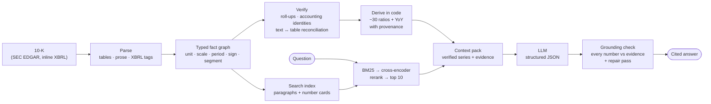

# 10k-graphrag

**Ask questions about SEC 10-K filings and get answers where every number is traceable to the filing, computed in code, and checked before you see it.**

[](https://github.com/andreasnikolaidis3142/10k-graphrag/actions/workflows/tests.yml)


LLMs rarely fail at finance because they can't read. They fail because a bare `4,620` in a table has no unit, scale,
period, sign convention or relationship to other numbers, so the model guesses, miscopies a digit, mixes thousands with
millions, or does arithmetic wrong. **tenk-graphrag gives every number all of that context before an LLM sees it**, does
the maths in code, and makes the model interpret verified facts instead of crunching them.

---

## Results at a glance

| What was measured | Before | After |
|---|---|---|
| Retrieval: answer reaches the LLM (373 questions, 5 companies, no LLM in the loop) | 30% | **96%** |
| Retrieval on held-out questions never used for tuning (73) | 34% | **97%** |
| Answer quality, Apple FY2023 (10 analyst questions, 10-point rubric) | 7.68 | **9.00** |
| Answer quality, Walmart FY2024 (8 re-rated questions) | 6.31 | **9.09** |
| Unit tests | | **162 passing** |

Companies covered in evaluation: **Apple, Walmart, JPMorgan Chase, ExxonMobil, Pfizer**, which span tech, retail,
banking, energy and pharma, each with very different filing layouts. Answer keys come from an **independent** inline-XBRL
parser, so the benchmark can't inherit the system's own parsing mistakes. Full write-ups are in [`eval/`](eval/).

## Example output

> **Q: How much cash did Apple generate in FY2023, and how did it return it to shareholders?**
>
> Apple generated **$110.54B** of operating cash flow `[F00224]` and spent **$10.96B** on property, plant and equipment
> `[F00236]`, producing **$99.58B** of free cash flow `[F01389]`. It returned **$92.58B** to shareholders `[F01448]`:
> **$77.55B** of buybacks `[F00251]` and **$15.03B** of dividends `[F00248]`, equal to **93.0%** of free cash flow
> `[F01451]`.
>
> *model: free OpenRouter model · ungrounded numbers: **none** · uncited claims: **0** · accounting identities checked: 1 passed, 0 failed*

Every `[F…]` / `[T…]` tag is a node in the graph. `python -m tenk_graphrag explain graph.json F01389` prints its full
provenance (free cash flow = CFO − capex, with both inputs and where they were printed in the filing).
Full answer with drivers, red flags, data-quality notes and follow-ups: [`examples/apple_fy2023_cash_returns.md`](examples/apple_fy2023_cash_returns.md).

### What the LLM actually receives

The model never sees raw tables. It gets verified series with their semantics spelled out, and changes that were already computed
(`--no-llm` prints this):

```text
SERIES GrossMarginPct - Gross margin %
  VIEW: DERIVED ratio/metric = GrossProfit / Revenues x 100 (already computed; do not recompute);
        unit is PERCENT - differences are percentage points, not %
  FY2021                41.8%  [F01390]
  FY2022                43.3%  [F01391]
  FY2023                44.1%  [F01392]
  PRE-COMPUTED FINDINGS (treat as facts):
   - FY2022: 43.3% vs 41.8% (+153 bps) [F01391]
   - FY2023: 44.1% vs 43.3% (+82 bps) [F01392]
```

## How it works



1. **Parse.** Inline-XBRL tags give exact concept, period, dimension, sign and scale. Tables are parsed with rules for
   `(in millions)`, `(1,234)` negatives, `—` zeros, mixed per-row scales, multi-level headers, fiscal years that are not
   calendar years, per-share vs share-count units. Prose numbers such as *"up 12%"*, *"150 bps"* or *"$4.9 to $5.1 billion"* are
   extracted and typed too.
2. **Graph.** Every number becomes a typed `Fact` node in a property graph (networkx), linked to its statement, segment,
   parent total (`ROLLS_UP_TO`) and the paragraphs that explain it.
3. **Verify.** Subtotals are checked against their components, accounting identities (A = L + E, gross profit, Δcash, …)
   become `Validation` nodes, and numbers in management text are reconciled against the tables (`VERIFIES` /
   `CONTRADICTS`). Disagreements surface as red flags.
4. **Derive.** Margins, free cash flow, net debt, ROE, days-inventory and other ratios (about 30), plus every year-over-year change, are computed
   in code and stored with `DERIVED_FROM` edges. The LLM is told never to recompute.
5. **Retrieve.** BM25 over paragraphs (each carrying its heading path) and **number cards**: one self-describing
   sentence per table row and per XBRL series. The top 50 are reranked by a cross-encoder (`BAAI/bge-reranker-base`) and
   the top 10 go to the model.
6. **Answer and check.** The model returns structured JSON. Every number in it is matched against the evidence. Ungrounded
   numbers trigger a repair pass and are reported if they survive.

### Number cards: making tables searchable

A table row like `Research and development | $29,915 | 14% | $26,251 | 20% | $21,914` is close to invisible to text
search. The system turns it into a sentence that a search engine and a reranker can match against *"How much did Apple spend on
R&D?"* (real card from Apple's FY2023 10-K):

```text
Item 6. [Reserved] > Operating Expenses | Operating expenses for 2023, 2022 and 2021 were as follows (dollars in millions):
| dollars in millions || Research and development: 2023: $29,915 ($29.9 billion); Change: 14%; 2022: $26,251
($26.3 billion); Change: 20%; 2021: $21,914 ($21.9 billion)
```

This one idea, plus heading context and finance vocabulary (*capex → payments for property, plant and equipment*,
*NIM → net yield*, *bottom line → net income*), took retrieval from **30% to 96%**. The full before/after analysis is in
[`eval/RETRIEVAL_OPTIMIZATION.md`](eval/RETRIEVAL_OPTIMIZATION.md).

## What this project demonstrates

- **Production-minded RAG design.** BM25, dense, hybrid (RRF) and cross-encoder reranking modes, plus query expansion.
  Changes were judged on a fixed benchmark with a held-out split, not by eye.
- **GraphRAG with a real schema.** Typed nodes and edges for facts, concepts, segments, validations and provenance,
  not just "chunks in a vector DB".
- **Hallucination control for numbers.** Code computes, the LLM explains, and a verifier checks every number it writes.
- **Evaluation discipline.** An independent answer key, a held-out split, a 10-point rubric (numeric accuracy,
  grounding, completeness, honesty, analyst value), before/after logs for every fix, and regressions tracked.
- **Domain depth in financial reporting.** XBRL, statement roll-ups, stock vs flow, fiscal calendars, segment
  attribution, bank-specific line items.
- **Working on a budget.** Runs on free OpenRouter models with rotation, retries and rate-limit handling. The search stack
  runs on a laptop CPU.
- **Test coverage.** 162 tests. Every fix in the evaluation log ships with a regression test.

## Quick start

```bash
git clone https://github.com/andreasnikolaidis3142/10k-graphrag.git && cd 10k-graphrag
pip install -r requirements.txt

# 1. Inspect the evidence the model would get. No API key and no download needed (Apple FY2023 graph is included)
python -m tenk_graphrag ask eval/aapl_2023.json "How did gross margin change and why?" --no-llm

# 2. Ask with an LLM (free OpenRouter key)
export OPENROUTER_API_KEY=...            # or put it in .env
python -m tenk_graphrag ask eval/aapl_2023.json "Is the balance sheet healthy? Look at liquidity, debt and net cash."

# 3. Any company: fetch from SEC EDGAR and build its graph
export SEC_USER_AGENT="Your Name you@example.com"   # SEC requires a contact string
python -m tenk_graphrag fetch --company MSFT --year 2023
python -m tenk_graphrag build --company MSFT --year 2023 --out msft.json
python -m tenk_graphrag ask msft.json "Which segment drove revenue growth, and are there red flags?"
```

More commands:

```bash
python -m tenk_graphrag flags graph.json                 # cross-statement red-flag screen
python -m tenk_graphrag explain graph.json F00116        # provenance chain of any number
python -m tenk_graphrag scenarios graph.json '{"Base":{}, "Bear":{"revenue_growth":-0.05,"gross_margin":0.38}}'
python -m tenk_graphrag models                           # currently available free models
pytest -q                                                # 162 tests, no models or network needed
```

## Project layout

```text
tenk_graphrag/
  edgar.py         SEC EDGAR download (ticker/CIK -> 10-K)
  loader.py        HTML / inline-XBRL -> blocks (headings, paragraphs, tables) + XBRL facts
  table_parser.py  periods, scales, negatives, units, segments from financial tables
  narrative.py     numbers in prose: levels, changes, %, bps, ranges, guidance, covenants
  taxonomy.py      label -> concept mapping (US-GAAP aligned)
  graph_builder.py typed property graph, roll-ups, identities, text <-> table reconciliation
  derived.py       ratios and YoY as derived facts with provenance
  signals.py       inflections, trends, CAGR, red-flag screen
  cards.py         number cards, heading context, finance query vocabulary
  retrieval.py     query planning, BM25 / dense / hybrid / cross-encoder rerank, context pack
  answer.py        prompt, JSON parsing, grounding verifier and repair pass
  llm.py           OpenRouter client: free-model discovery, rotation, retries
  scenarios.py     driver-based projections and scenario comparison
tests/             162 tests with small synthetic filings
eval/              evaluation reports, per-question answers and the retrieval benchmark
examples/          sample answers
```

## Number handling reference

| Number in a 10-K | Handling |
|---|---|
| Statement lines with `(in thousands/millions)`, mixed scales per table or row | scale detected; values normalised to base units |
| `(1,234)`, `$(5)`, `—`, `n/m` | negative / zero (flagged) / skipped |
| Cash outflows printed negative (capex, buybacks, dividends) | stored by a per-concept sign rule that matches XBRL |
| Flow vs stock | `duration` (12M, quarter, YTD) vs `instant`; balance sheets are always instant |
| Fiscal year ≠ calendar year, "Three Months Ended" | period ids such as `FY2023`, `Q2-2023`, `@2023-12-31` |
| Per-share, share counts, %, bps, multiples, days | separate units, never mixed with USD |
| Subtotals / totals | roll-up inference and per-period verification |
| Segment / geography / product breakdowns | dimensions + `ROLLS_UP_TO` the consolidated total |
| Accounting identities (GP, EBIT, NI, A = L + E, Δcash) | `Validation` nodes; failures surface as warnings |
| Prose numbers (changes, ranges, guidance, covenants, debt terms) | typed, then reconciled to tables |
| Ratios and growth | computed in code; the LLM is told not to recompute |
| Numbers in the LLM's answer | verified against the evidence; ungrounded ones trigger a repair pass |

## Known limits

- **Outside data.** Market-based metrics (EV, P/E, market cap) need a share price, which a 10-K doesn't contain.
- **Table parsing.** Rule-based. Unusual layouts can still produce unmapped labels. These are kept as `custom:` facts with low confidence, not dropped.
- **Model quality.** Free models vary in quality and availability. Numbers are protected by the verifier, but prose quality follows the model.
- **Speed.** The cross-encoder costs about 15–20 s per question on a CPU. `TENK_TOP_K_CANDIDATES` trades quality for speed.
- **Scenarios.** The scenario engine is a simple driver model, not a full three-statement model.

## License

MIT. See [LICENSE](LICENSE).
